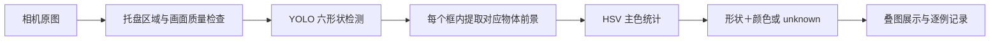

# 中期检查视觉方案：六形状 YOLO 检测＋传统颜色识别

状态：**设计稿，已有一张用户用手机大致模拟机位的参考照片；尚未用正式相机采主数据、训练模型或实物验证**。当前阶段的必达目标是[Windows 本地六形状 YOLO 模型](local-yolo-six-shape-training-checklist-2026-11-10.md)；本文件还保留六色传统识别的后续方案。自动拨料与 Orange Pi 5 Plus 部署均为后续独立工作。旧的三类积木公开数据集只用于练手，不能当成本轮六形状测试结果。

## 1. 目标和输出

输入为实际机位拍摄的托盘照片或视频帧。每个可见物体输出 `形状、颜色、检测框、形状置信信息、颜色判定状态`，并在原图上显示；颜色或形状证据不足时输出 `unknown` 和原因。中期演示报告只写实测的识别成绩与适用场景，不用模拟分拣结果代替实物识别。

YOLO 是普通目标检测，标**矩形框**，不要求逐像素掩码标注。颜色作为独立模块，按原始相机画面计算。首批形状类 ID 固定如下，后续拍摄、标签、训练和展示均保持同一顺序：

| ID | 英文键 | 中文名 |
| --- | --- | --- |
| 0 | `cube` | 正方体 |
| 1 | `sph` | 球体 |
| 2 | `cyl` | 圆柱体 |
| 3 | `tpri` | 三棱柱 |
| 4 | `cone` | 圆锥体 |
| 5 | `tet` | 四面体 |

2026-11-11 用户确认六色为黑、白、红、黄、深蓝、浅蓝；具体 HSV/亮度/饱和度阈值仍需用这些实物在实际相机、照明、曝光设置下标定。拍摄数量与分批配额见[约 800 张数据集方案](midterm-yolov8n-dataset-800-plan-2026-11-11.md)。

## 2. 先过机位可辨性关口

大规模拍摄前，先把这六类实物逐个放在正式托盘上，以候选机位拍正上方与斜视照片，检查**人能否仅凭该画面可靠区分**。球、圆柱、圆锥从正上方可能都显圆形；三棱柱和四面体在部分朝向也可能投影相近。模型无法从完全看不到的侧面恢复可靠类别。优先选能看到顶面和一部分侧面的固定视角，同时保证全部工作区入镜、目标像素足够；具体角度由照片比较决定。若单个视角不能兼顾定位和识形，再评估现有第二个相机，不能靠多拍同一俯视角解决。

相机、托盘、灯固定后再采主数据。尽量保持曝光、增益和白平衡一致，减少环境杂光和高光；保留空托盘参考图，并记录相机编号、分辨率和灯光条件。机位或成像设置改变，颜色阈值与背景参考都要重新检查。任何托盘平面坐标标定只服务后续定位，物体顶部像素不能直接当托盘平面坐标去驱动拨料。

### 2026-11-10 手机模拟机位照片的初评

用户提供一张手机拍摄、**大致模仿相机视角**的托盘照片，原附件仅在用户电脑临时目录，未入仓库。照片整体并非明显欠曝，彩色物体可辨；同时可见白色托盘亮斑与阴影、黑色物体暗面细节不足、左侧机构占视野及部分物体相互遮挡。这只能说明照明和机位有改进空间，不能推断正式相机画质或模型表现。

已有灯带建议用于建立稳定、均匀的白光环境：优先在托盘两侧或上方对称布置，做柔光/漫反射，避免灯珠直照白色底板造成高光、避免灯带进入视野或被机构遮挡。单侧直射可能加重阴影。装灯后用正式相机在固定曝光/白平衡下分别拍空盘、六色物体和黑色物体，比较灯开/关时的阴影、亮斑、暗面细节、颜色漂移与连续帧闪烁；选定设置后保持一致，再采训练及颜色标定图。不要只根据手机自动曝光画面决定灯亮度或 HSV 阈值。

## 3. 数据采集与检测框标注

以**独立重新摆放的场景**计数，不把连续视频中几乎相同的帧充作独立样本。2026-11-11 将原先“第一轮 300–500 张”预算改成分批采集：先拍并精标约 60–100 张，训练初版，再按错例补拍；当前约 800 张上限的具体类型和数量以[数据集拍摄方案](midterm-yolov8n-dataset-800-plan-2026-11-11.md)为准。数量随实测效果调整，800 张不是开工门槛。兼顾单件、稀疏多件、轻微接触、不同位置/旋转/倾斜、阴影/反光、空盘。中期演示若仅承诺单层场景，仍应留少量贴近或遮挡图作为边界测试，不必让严重堆叠主导首版训练集。

首批每种形状先争取约 15–30 个**可辨认的框标注实例**，后续按逐类错例增加；每种颜色尽量在不同位置和多种形状上采样，再留空盘、阴影和机构入镜的负样本。场景照片数与框实例数分别统计，不能相互替代。若实物组合做不到上述覆盖，应先记录缺项，并在评估表中单列，不用重复拍同一摆放凑数。

为防止 YOLO 学成“颜色代替形状”，尽量使**每种形状出现在多种颜色、每种颜色出现在多种形状**。建立实际拥有的形状×颜色组合清单；若有缺项，报告数据覆盖范围，不假称覆盖 36 个组合。每次拍摄记录批次、实物编号、形状、颜色、摆放、光照和机位；保留原始未增强图片。若每类只有一个实物样品，测试只能证明对这批样品及其摆放有效，不能证明换材质或尺寸也能识别。

标注工具中每个**可辨认的可见物体**画一框，框住其可见部分并给真实形状 ID；一致使用可见外接框，不混入猜测的完整遮挡轮廓。多件图片要标全。无法从画面判别类别的严重遮挡样本单独放审核/难例集，不要遗漏在训练图中让物体变成“背景”。空盘图不标目标。可由简洁背景分割生成候选框、按拍摄批次带入候选类别，但每张都要人工复核漏框、错类、框过大和接触物体合并。

YOLO 检测标签为每个物体一行 `class x_center y_center width height`，坐标按图宽高归一化，类别从 0 开始；类别顺序和 `data.yaml` 一致。[Ultralytics 检测数据格式](https://docs.ultralytics.com/datasets/detect/)

按**拍摄批次/重新摆放组**划分训练、验证、测试，而非随机分开相邻视频帧；同一摆放的多视角图也放同一组。可先按约 70/15/15 分，另外保存一批最终盲测的新摆放照片。测试集在调参数期间不反复用于挑模型或调颜色阈值。

## 4. YOLO 六形状训练

首个基线沿用项目已有调研的预训练 `YOLOv8n` 检测模型，输入尺寸先试 640；这也与 Rockchip 官方 YOLOv8 RK3588 示例对接。先用少量标注图短跑，确认类别 ID、框、推理叠图和训练链路正确，再用全量训练集训练，按验证集选权重。批量大小、轮数、早停和输入尺寸以本机 GPU/显存及目标像素尺寸实测调整，保存模型版本、数据版本和训练配置。不要把 Roboflow 页面上的分数当成本项目成绩。[Ultralytics 训练模式](https://docs.ultralytics.com/modes/train)、[Rockchip YOLOv8 示例](https://github.com/airockchip/rknn_model_zoo/blob/main/examples/yolov8/README.md)

YOLO **只学形状**，训练时适度色相/亮度变化可帮助减少“某种形状总是某种颜色”的捷径，但必须目视检查增强图是否仍像真实物料；实际颜色模块的标定、验证和推理只使用相机原图，不使用训练增强图。真实形状跨颜色拍摄仍是主要依据。[Ultralytics 增强参数](https://docs.ultralytics.com/guides/yolo-data-augmentation)

验证先看每类混淆、漏检和误检，特别看球/圆柱/圆锥及三棱柱/四面体；再决定补拍哪个朝向、改变机位或调整模型，而不是仅看一个总体 mAP。对同图输出记录置信度，但不把模型分数当成真实正确概率。

## 5. 框内传统颜色模块

### 5.1 取对应物体像素

1. 从**原分辨率 BGR 图**取 YOLO 框内 ROI，暂不使用被缩放、补边的网络输入图做颜色统计。
2. 固定机位先拍空托盘参考图。在同一位置比较当前帧与空托盘，得到前景候选；阈值由多张空托盘图的噪声范围和实物图确定，随后做适量开闭运算。与检测框相交，只保留属于该目标的连通区域，避开其他检测框、托盘边和挡板；轻微腐蚀边缘，减少背景色、阴影和抗锯齿混入。固定机位做前景掩码是传统计算机视觉方法，不需要训练 YOLO 分割模型。[OpenCV 背景减除](https://docs.opencv.org/4.11.0/d1/dc5/tutorial_background_subtraction.html)
3. 背景差分在光照骤变、目标和托盘颜色相近、物体接触后前景连成一片时可能失败。此时标记 `mask_invalid`，不要把整框的颜色硬判给该物体。若实拍证明简单单件目标的框中央区域足够纯净，可把中央小区域作为**单件限定回退**，同时记录采用了回退。只有接触场景确实成为瓶颈时，才考虑更复杂的传统分离或 YOLO 实例分割；实例分割需要额外的每实例掩码标签。[Ultralytics 分割任务](https://docs.ultralytics.com/tasks/segment/)

### 5.2 判颜色

对有效掩码内的像素转 HSV，先排除明显阴影、强反光和边缘混色，再按校准得到的各颜色范围统计像素占比。OpenCV 8 位 HSV 的 H 范围为 0–179；红色须处理跨 0/179 的两段。若六色中有白、灰、黑等低饱和色，H 不可靠，要结合 S/V，必要时比较 Lab；不能给所有颜色套同一组 H 阈值。[OpenCV 颜色空间](https://docs.opencv.org/4.11.0/df/d9d/tutorial_py_colorspaces.html)、[HSV 阈值](https://docs.opencv.org/4.x/da/d97/tutorial_threshold_inRange.html)

阈值、最小有效像素量、主色占比和第一/第二候选差距都只用**训练/校准集**中的实拍样本确定，并在验证集上调稳；若有效像素太少、两色接近或掩码失效，输出 `unknown`。记录 `mask_valid_ratio`、各色像素占比、最终颜色与拒判原因，便于区分“模型框错了”和“颜色规则错了”。六色名称已确定，具体阈值表待实拍后建立。

校准时每色选不同形状、托盘中心/边缘、允许的灯光变化分别取样，并人工检查掩码是否真正落在物体表面；用这些像素的 H/S/V 分布定范围和拒判条件。验证集只用于比较候选阈值，盲测集仅在规则冻结后运行。空托盘参考图只在**确认没有物体**时更新，避免把静止物体吸收到背景。

## 6. 验证和中期展示

建议固定一批未参与训练、阈值调整的实拍场景，覆盖六形状、六颜色、空盘、不同摆放和允许的轻接触。分别报告：

盲测规模可先争取每种形状至少 20 个独立重新摆放的实例，并保证每种颜色都有样本，再加入空盘和预期边界场景；若样本不足，报告真实分母。记录拍摄批次与物体实例，避免训练/测试实际上是同一次摆放的近重复画面。

| 层次 | 统计什么 | 目的 |
| --- | --- | --- |
| YOLO | 每类检测召回、误检、形状混淆、mAP 与样例 | 找出看不见/看错的形状 |
| 颜色规则 | 在**人工真值框**内判色准确数、拒判数；再在模型框内重复 | 分离颜色算法本身与检测框误差 |
| 联合结果 | 每个真实物体“框对应＋形状正确＋颜色正确”的比例、漏检与 unknown；按摆放/光照分组 | 反映观众看到的实际结果 |
| 演示运行 | 原图、框、掩码可视化、六类/六色文字、错误样例和处理速度 | 结果可复查，不只展示成功案例 |

第一道验收是**相机画面中六类在人眼看来可辨**；第二道验收是训练和颜色阈值固定后，在盲测集上报告实际数字和失败边界。中期展示可以限定“单层、固定光照、稀疏摆放”，并用几张接触/反光难例说明何时拒判；不能把这个范围写成任意堆叠已解决。若要设目标值，可把限定场景的联合正确率 ≥90% 作为内部改进目标，**不是既有结果或赛事要求**；未达到时按错例类型补拍/调机位/改掩码。

## 7. 和现有上位机的边界与实施顺序

现有 [`vision.py`](../software/upper-computer/sorting_app/vision.py) 的 `BasicDetector` 只有红、绿、蓝、黄等演示颜色和二维轮廓；不能直接称为六种三维形状识别。以后可新增实现 `detect(image) -> list[Detection]` 的检测器，输出稳定的 `shape`、`color`、像素框及状态，并在 GUI 与命令行入口替换 `BasicDetector`。现有非演示分拣还要求 `shape_verified` 和 `surface` 等条件，正式分类口径、坐标与队友固件接口未统一；视觉叠图通过不等于可启动实物自动分拣。[上位机接入说明](../software/upper-computer/docs/开发接入.md)

| 顺序 | 交付物 | 通过条件 |
| --- | --- | --- |
| 1 | 机位试拍、六形状可辨性照片、六色实物清单 | 确定演示视角与范围 |
| 2 | 原图、框标签、分组划分、空盘参考 | 抽检标签无明显漏标/错标，测试集独立 |
| 3 | 六类 YOLO 权重、逐类测试结果 | 未见过的摆放能输出合理框与形状 |
| 4 | 前景掩码、六色校准表、拒判规则 | 独立照片可解释地判色或拒判 |
| 5 | 逐帧叠图演示、联合结果表、失败样例 | 中期展示内容与实测范围一致 |
| 6（可选后续） | 上位机接口及 Orange Pi 5 Plus 部署 | 不属于当前 Windows 本地 `best.pt` 交付范围；若将来需要，再分别做软件、板端和实物联调 |

当前最影响具体参数的缺失信息：**六色实物组合覆盖、最终相机视角/背景、灯光条件、中期检查是照片演示还是实时视频**。六色名称已确认；拿到实拍图后再定颜色阈值和是否需要第二机位。
