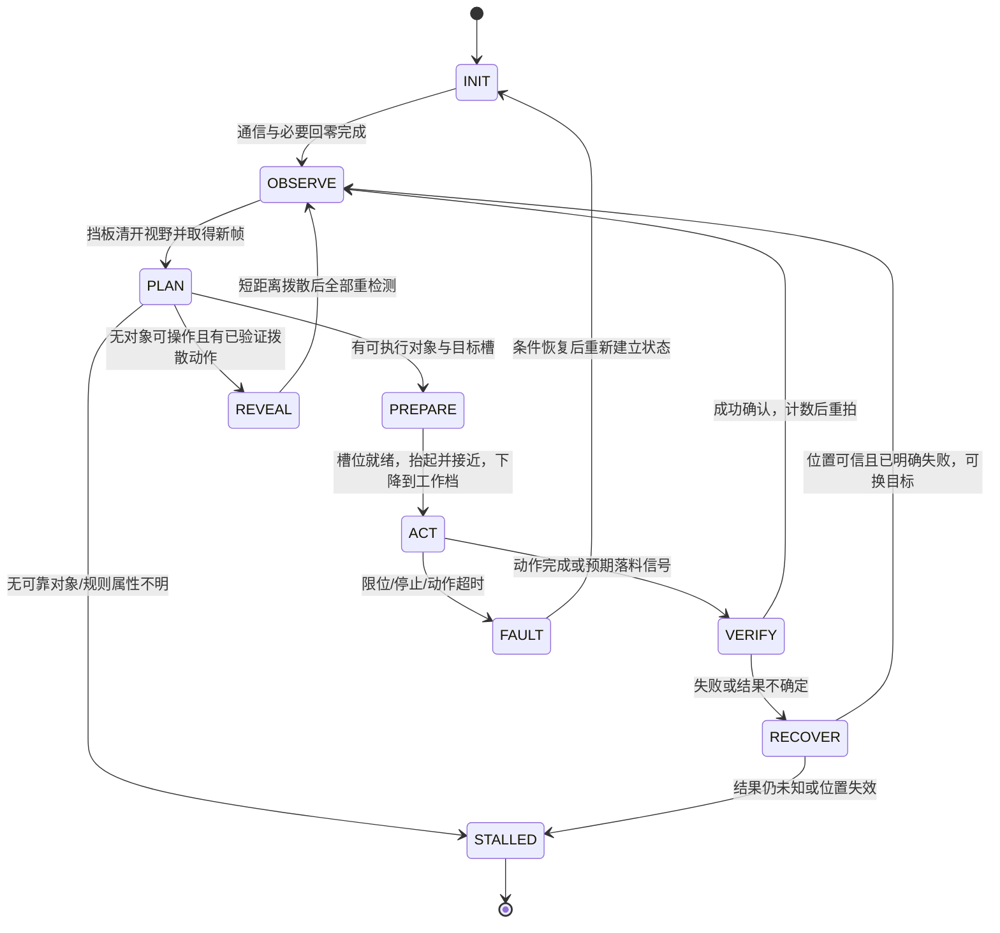

# Vision-Claw 视觉、拨料与抓取系统：六套方案比较及实施设计

调研日期：2026-11-04，Asia/Singapore。性质：仓库审计、公开资料调研和工程设计；**没有训练模型、转换 RKNN、连接香橙派、烧录或启动机构，没有新增实物测试结果。**

> 2026-11-08 归档说明：本文保留11月4日的调研快照。本机后续004/005对话已记录用户确认实物为 **Orange Pi 5 Plus**、已进入桌面并完成SSH登录，替代本文当时“Orange Pi 5/RK3588S、系统未确认”的设备假设；尚无NPU推理实测。视觉分支[既有003记录](https://github.com/lldb-123/Vision-Claw/blob/codex/vision-yolo/ai-dialogue/2026-11-04-003-vision-yolo.md)另已确认八种形状（正方体、球体、四棱锥、圆柱、圆锥、五棱柱、六棱柱、正四面体）、颜色识别、单层优先及可用两个相机，测距传感器尚未购买。实际实施沿用这些确认信息；下文六方案是候选比较，不代表已决定增加深度设备、夹爪或主动拨散。本对话归档记录为[006](../ai-dialogue/2026-11-04-006-vision-options-research.md)。

## 1. 结论与适用范围

**当前推荐：先实现方案 C「YOLOv8n 检测＋OpenCV 轮廓/颜色＋平面几何＋拨料通道规划」，以方案 A 作为最小基线；同色接触、轮廓粘连成为主要失败原因时升级方案 B「实例分割」。只有实物试验证明高度/上下层判断是主要瓶颈时，再增加方案 D 的深度传感器。**

建议把精力先放在固定机位、照明、真实数据、接触位置、可行拨料通道和逐件重检测上。大多数物体简单摆放时，这些工作的收益通常大于一开始建设完整六自由度抓取系统。这个优先级是基于本项目的工程判断，尚未用实物对照实验验证。

用户口述出现「小车、机械臂、抓取」，但已提交仓库及对话确认的是 **X/Y 两个步进轴、Z 轴 MG90S 舵机驱动 L 型挡板、DS3120 六槽转盘，通过拨料落入对应槽**。因此本文主线把“抓取顺序”落实为“选取对象、接近、拨送、落料顺序”。夹爪相关内容作为增加真实夹爪/机械臂后的完整扩展，不假装已有夹爪、腕部旋转或六自由度执行能力。

六套方案共享相机、任务和执行接口，每套都有完整闭环；差异在几何信息和决策机制，不在简单更换 YOLO 版本：

| 方案 | 核心信息与定位 | 决策依据 | 额外硬件 | 当前适配程度 | 主要边界 |
|---|---|---|---|---|---|
| A 检测＋规则 | YOLOv8n 框，固定平面坐标 | 保守矩形占据区、预设拨料通道 | 无 | 最快形成基线 | 接触/堆叠时过于保守，无法证明上下层 |
| B 实例分割＋闭环 | YOLOv8n-seg 每实例掩膜 | 可接触边、真实可见间隙、操作区 | 无 | 拥挤二维场景首选升级 | 掩膜仍是可见表面，不是完整三维体积 |
| C 检测＋传统视觉/几何 | YOLOv8n 分类，颜色/轮廓/方向细化 | 形状拟合、接触偏移、方向约束 | 无 | 推荐初赛主线 | 同色紧贴、严重遮挡会使几何拟合失效 |
| D RGB-D＋高度/点云 | 分割＋真实深度、托盘高度图 | 上层、体积碰撞、2.5D 或 3D 路径 | 深度相机；夹取另需夹爪 | 高度确为瓶颈时选 | 深度空洞、最小工作距离、标定和成本 |
| E 多视角＋主动观察 | 顶视和斜视融合，必要时三角化 | 可见性、遮挡关系、观测收益 | 第二相机或已标定观测位 | 侧面标识/遮挡突出时选 | 多相机不能保证所有隐藏面可见 |
| F 学习式操作评分 | 检测/分割＋动作价值网络；夹爪可用 GG-CNN | 候选动作的学习成功率，仍受几何约束 | 拨料分支可沿用 RGB；夹爪分支需深度与夹爪 | 研究扩展 | 需真实动作数据，现成抓取权重不适配 L 板 |

## 2. 已知信息、冲突和代码缺口

### 2.1 核对依据

GitHub 连接器和公开网页本次返回 404，但本机已配置的 Git 远端可以只读访问。`git ls-remote origin HEAD refs/heads/main refs/heads/master` 返回远端 HEAD/main 为 `3cf7917f26a4fcb369b974a9636c0f6fd3a8b3cd`，与本地 HEAD 相同。没有拉取覆盖工作区。硬件和软件源码本次无已有未提交改动；对话目录存在前一轮未提交记录，予以保留。

| 项目 | 证据与状态 | 设计影响 |
|---|---|---|
| 现场计算 | 采购/方案为 Orange Pi 5 8GB；用户本轮补充 RK3588S/NPU | 按板端离线推理设计；板上系统/Runtime 尚未确认 |
| 训练 | 用户本轮：Windows、RTX 5060，可租 4090/5090 | PC/云训练，板端只推理；不假定 GPU 显存或训练时长 |
| 执行器 | [硬件说明](../hardware/README.md)、[001记录](../ai-dialogue/2026-11-03-001-project-and-motor.md)：X/Y 42 步进、Z MG90S、转盘 DS3120 | Z 首先按舵机档位设计，不直接当直线步进轴 |
| 相机 | 采购表 Sheet1 C9：微雪 OV2735 USB 2.0，数量 1 | 没有深度传感器已安装证据；镜头、帧率、机位待量测 |
| 传感器 | 采购含对射光电、KW11 限位 | 采购不等于接好；不能直接声称有入盒/回零反馈 |
| 视觉实现 | [vision.py](../software/upper-computer/sorting_app/vision.py)：HSV、外轮廓、四点平面变换 | 没有 YOLO 权重、RKNN 模型、深度或真实数据集 |
| 调度实现 | [engine.py](../software/upper-computer/sorting_app/engine.py)：每轮拍照，取 detections[0]，发 SORT | 已有逐件循环，但没有可行通道、上下层或抓取评分 |
| 完成状态 | 演示协议要求 `ENTRY_VERIFIED`，否则不计成功 | 执行完成、落料经过、可靠入盒须区分 |
| 下位机 | [固件框架](../firmware/stm32-motion-framework/README_MOTION.md)为 X/Y HAL 框架、文本 MOVE/GOTO | 不支持上位机演示 SORT 协议；没有完整 Z/转盘动作实现 |
| 参数 | 1280×720、260×260 mm、180 s、12 s 动作超时 | 开发配置，不是实测尺寸、正式规则或真实性能 |
| 装配 | 有 L挡板、Z轴限位、托盘等 SolidWorks 文件 | 存在文件不代表已解析尺寸/完成干涉检查 |

细项证据见[仓库审计](research/2026-11-04-repository-audit.md)。本轮没有操作 CAD 装配来核验实体尺寸。

### 2.2 明确的冲突处理

1. 按用户要求优先沿用旧仓库：主线是拨料，不能用新口述把它改写成已经存在的多关节机械臂。
2. `team.pdf` 写初赛与决赛都涉及颜色、形状及表面信息；本轮用户描述为初赛简单、决赛有二维码/污渍。**实现范围按本轮要求延期二维码，但不能据此保证正式初赛绝不涉及表面信息。** 提交方案和粗填命题文档均不是已核实的正式规则。
3. 六槽是当前机构；不是所有赛事可能类别只有六种，也不是“每种颜色固定一槽”。正式同类判定、同时出现类别数、槽位容量和得分口径待规则确认。
4. 早期从左下到右上的顺序只能是启发式。图像坐标的“靠下”不能当作三维“位于上层”。

### 2.3 现在无需等待，但实施前必须补齐的五项

- 托盘与落料口实测几何、最大物块尺寸/高度、L 板水平外形和实际可用拨送方向。
- 相机固定在框架还是随机构移动；成像高度、视野、最小目标像素尺寸。
- Z 舵机连杆关系、抬起/拨料两个档位的重复误差；X/Y 原点与行程。
- 最终类别/评分规则、是否允许主动拨散、二维码是否需要内容、标识是否可能在底面。
- MCU 与上位机采用哪个正式协议、哪些动作/传感器状态真正可反馈。

## 3. 把五个任务拆开

| 任务 | 合格输出 | 不能由它直接推导的结论 |
|---|---|---|
| 检测到物体 | 一个可见实例及框/掩膜 | 类别正确、完整边界、可移动 |
| 识别类别 | 形状/颜色/表面属性及不确定状态 | 圆形投影一定是圆柱；看不见二维码就是无二维码 |
| 估计位置 | 带坐标系、单位和误差的接触点/位姿 | 框中心是物理中心；平面坐标适合堆叠顶部 |
| 判断可操作 | 与执行器相符的接近和动作路径、间隙、可达约束 | 物体未被压住、摩擦稳定、动作一定成功 |
| 执行成功 | 物体状态变化、落料/入盒判据 | 发完脉冲或 MCU 的动作 DONE 就是分拣正确 |

**完全不可见的目标不能凭当前图像恢复其类别、位置或抓取点。** 可保留“此区域可能还有物体”的历史假设；移走上方目标或改变视角后重新观察。生成式补全、SAM 或单目深度都不能把无观测事实变成可靠执行依据。

轻遮挡可凭局部特征识别；严重遮挡只能对可见部分产生候选，类别与动作置信度分开。分割比框多提供每实例可见边界、邻接关系、可见面积、局部方向与接触边。它不天然输出隐藏轮廓、承重关系、真实厚度或上层标记。单幅 RGB 的 T 形边界和阴影只能作为弱线索。

每次移动一个物体后重拍、重建候选和路径。旧顺序不能整批执行，因为拨动、滚动、滑落都会使邻近目标改变。静止分拣优先使用简单 IoU/中心匹配维护短时 ID，不必先部署复杂视频跟踪器；重排后允许 ID 失效。

## 4. 共用数据接口、几何约束和决策算法

以下是**建议接口与伪代码，未加入运行程序**。每套方案替换 `perceive`、`propose_actions` 和证据生成器即可；初赛关闭的模块返回 `not_requested/unknown`，不伪造负结果。

```python
Scene = {
  "frame_id": int, "captured_at_monotonic": float,
  "calibration_id": str, "coordinate_frame": "tray_mm",
  "objects": list, "unknown_regions": list, "machine_state": dict
}
Object = {
  "id": str, "bbox_xyxy": list, "mask": None, "det_conf": float,
  "shape": {"value": None, "confidence": None},
  "color": {"value": None, "confidence": None},
  "surface": {"qr_present": "unknown", "stain": "unknown"},
  "qr": {"status": "not_requested", "polygon": None, "payload": None},
  "reference_xyz_mm": None, "xy_error_bound_mm": None,
  "height_mm": None, "height_source": "unknown",
  "blockers": [], "visible_fraction": None, "attempts": 0
}
Action = {
  "kind": "push_to_exit",  # 也可 observe/reveal/pick_place
  "object_id": str, "scene_frame_id": int, "bin_id": int,
  "contact_xy_mm": list, "waypoints_xy_mm": list,
  "z_profile": "raised_then_work", "speed_profile": "gentle",
  "expected_effect": dict, "constraints_passed": list,
  "score": float, "evidence": dict
}
Result = {
  "accepted": bool, "motion_done": bool,
  "object_left_tray": "unknown", "entry_verified": "unknown",
  "failure_reason": None
}
```

### 4.1 定位与高度误差

固定相机先标定内参与畸变，再用托盘实测点建立 `s[x,y,1]^T = H[u,v,1]^T`。至少四个不共线点；实际用更多点检查中心/四角残差。标定图片与运行图片应使用相同去畸变、裁剪、缩放坐标。网络 letterbox 的比例和 padding 必须逆变换后再进 H。

H 只适用于所标定平面。光轴垂直时，设相机离托盘高度 Hc、物体上表面高度 h、真实位置距光轴 r，把顶部点当作托盘点会产生约 `e = r*h/(Hc-h)` 的横向偏差。例如 Hc=500、h=40、r=120 mm 时约 10.4 mm；**这是几何示例，不是本机测量**。不同高度可用已知高度平面校正，或以深度和外参恢复三维。倾斜物块不可直接套用类别的标称高度。平面与 PnP 原理见 [OpenCV homography](https://docs.opencv.org/4.x/d9/dab/tutorial_homography.html)、[solvePnP](https://docs.opencv.org/4.x/d5/d1f/calib3d_solvePnP.html)。

### 4.2 硬约束先于打分

令动作 a 的执行器和被移动物体完整扫掠区域为 W(a)，非目标障碍 O（含托盘壁、落料口边缘、其他物体和未知区域），综合误差界为 ε。候选至少满足：

```text
reachable(a) = True
W(a) ∩ inflate(O, ε) = ∅
target_route(a) 只通过允许的落料口，不跨越其它托盘边缘
class_attributes_required_by_rule 已知，目标槽可用
场景来自最后一次运动结束后的新帧，标定/回零状态有效
若执行 pick：夹爪开口范围、指厚、下探高度、腕姿态/IK均满足
若执行 push：接触面可进入、推动方向可实现、全程保持可解释接触
```

W 包括 L 板的两条边、连接件以及目标移动的宽度，不只是“目标中心的一条线”。无碰撞平移路线不一定能保持推动接触；固定方向 L 板不能绕过任意弯角。初版仅生成已由机械验证的直线/单次换边模板，复杂路径先拒绝或重定位后重拍。

障碍图不能只来自 YOLO 成功检出的目标。未识别前景、托盘固定件和挡板自身都须进入占据图：固定背景可靠时，可用背景差分、颜色无关边缘/前景分割形成 unknown 区域，与检测包络取并集。若背景法也不可靠，就不能宣称图上空白已经证明无物体；限制到经过验证的简单摆放范围。A 的纯检测基线尤其需要保留这条漏检边界。

纯 RGB 看不见下表面/侧后方时，使用已知最大物块包络膨胀掩膜；未知厚度或明显堆叠不能以二维无重叠直接放行动作。ε 可取标定、边界、传动间隙和重复定位误差的保守和，后续以实测误差分布收紧；不写死为 1 mm。

夹爪模型除了目标内部空间，还要检查两根手指接近区、闭合区、腕部/连杆和后续搬运扫掠体；“掩膜中心距边界最大”只给候选点。当前 L 板用“接触边长度、L 内角容纳空间、推送通道宽度”替代夹爪开口。

### 4.3 遮挡关系与选取评分

遮挡图的边 `j -> i` 表示有证据说明 j 妨碍对 i 的当前操作，记录 `source/confidence`。支撑关系与图像遮挡是不同关系。只有邻域空间重叠且深度/多视角证据相符，才用高低关系提出阻挡边；不能简单“谁高度大就挡住所有矮物体”。RGB 的弱边可提高代价，不能证明可靠无阻挡。若出现环或相互矛盾，重新观测，不强行拓扑排序。

先筛可行候选，再在每个方案可测的指标上打分：

`S(i,a) = wP*P + wC*C + wV*V + wT*T + wG*G + wQ*Q - wR*R - wD*D - wF*F`

- P：任务优先级/单位成功收益，规则未定时设相同；不套用草稿分数。
- C：经过验证/校准的检测与所需属性可靠度，不把 YOLO conf 当成功概率。
- V：可见比例，仅当有可信完整投影模板/额外标注时估计；`mask_area/bbox_area` 是紧致度，不是遮挡比例。
- T：可操作上层证据，仅深度/多视角/已知几何可给；RGB 未知不填 1。
- G：最小间隙除以所需间隙，截断到 [0,1]。
- Q：形状拟合或学习动作质量；不用的方案该项权重为 0。
- R：可行候选中的剩余碰撞/高度不确定风险；硬约束失败不能靠高分抵消。
- D：预计执行时间/本轮时间尺度，含转盘和绕路；F：同场景失败次数惩罚。

可用起始权重如下；它们是调参起点，**不代表已经验证的最优策略**。有未知必需指标的动作先拒绝/再观察，不能删掉该项后自动提高分数。无需该指标的工作模式才将对应权重全局设为 0。

| 方案 | wP | wC | wV | wT | wG | wQ | wR | wD | wF |
|---|---:|---:|---:|---:|---:|---:|---:|---:|---:|
| A 单层条件模式 | .15 | .20 | 0 | 0 | .35 | 0 | .20 | .20 | .30 |
| B 掩膜条件模式 | .15 | .15 | .10* | 0 | .35 | .10 | .25 | .15 | .30 |
| C 几何条件模式 | .15 | .15 | 0 | 0 | .25 | .25 | .25 | .15 | .30 |
| D 深度 | .15 | .10 | .10* | .20 | .20 | .15 | .30 | .15 | .30 |
| E 多视角 | .15 | .15 | .15* | .15* | .20 | .10 | .30 | .20 | .30 |
| F 学习动作 | .15 | .10 | 0 | .10* | .15 | .40 | .30 | .20 | .30 |

星号仅在证据具备时启用，否则该模式关闭此项且保留风险/适用条件。同分优先动作更短、所需重复尝试更少的目标。场景确有严重堆叠而上层不可判时，A/B/C 不选“看上去最明显”强推，而移除有已验证自由通道的外围物体或请求观察。

### 4.4 共用闭环伪代码

```python
while time_remaining > minimum_action_budget:
    move_to_observation_pose_if_needed()       # 同一观察位无需重复移动
    scene = perceive(fresh_frame_after_motion())
    scene = associate_short_lived_ids(scene, previous_scene)
    update_obstacles_and_unknown_regions(scene)
    candidates = propose_actions(scene, mechanism_profile)
    feasible = [a for a in candidates if hard_constraints(a, scene)]
    if not feasible:
        a = bounded_observe_or_reveal(scene)   # 最多一次/小预算；不默认盲拨
        if a is None:
            report_stalled_not_finished(); break
    else:
        a = max(feasible, key=score)
    result = execute_once_with_sequence_id(a)  # ACK丢失不重复物理动作
    after = capture_after_settle_and_clear_occlusion()
    outcome = verify_effect(a, result, after)
    if outcome.unknown:
        outcome = bounded_reobserve_and_query_result()  # 不重新发起原物理动作
        if outcome.unknown:
            report_unresolved_and_stop_automatic_sorting(); break
    update_counts_only_if_verified(outcome)     # 同一task_id只计一次
    if outcome.failed:
        invalidate_old_plan(); mark_failed_region(a)
        # 先看新场景；可换方向/降速/换目标，不原坐标无界重试
    previous_scene = after
```

“未检测到目标”与“比赛物料全部处理完”分开；严重遮挡、相机失败、未知类别或挡板挡住画面均可能产生空检测。

## 5. 方案 A：轻量检测＋保守规则与单层拨料

**流程：** 固定 RGB 采集→去畸变/托盘 ROI→YOLOv8n 检测形状类别→物块 ROI 颜色属性→框映射到参考平面→膨胀占据区→从预设直线通道中选对象→Z 抬起/接近/下降/拨送→确认落料→清场拍照。二维码/污渍模块走共用可选接口，初期关闭。

选 YOLOv8n 检测是因为有 Rockchip 官方转换与后处理示例，作为成熟基线；YOLOv5n 可以平行比较作为兼容回退。YOLO11n 是候选对照，不因更新而默认更好。A 不需要分割/OBB/姿态模型，CPU 做 NMS 与毫米映射；模型选择证据见第 12 节。

**具体决策：** 对每个检测框用已知物块最大尺寸修正占据区；按机械允许方向集合 D 生成候选接近边和推向落料口的模板；用完整 L 板与目标包络检验扫掠区。余下候选按 A 权重评分，近出口和净空大优先。规则要求的属性没识别全则不分配正式槽。

```text
for box in detections:
    if not in_validated_single_layer_regime(box): continue
    footprint = conservative_envelope(box, class_max_size, xy_error)
    for route in validated_push_templates(footprint, exit, fixed_L_orientation):
        if sweep_clear(route, other_envelopes): add_candidate(route)
choose max S_A; execute; re-detect; failed target cooldown for this scene
```

轻遮挡可以检测，但只执行已经用包络证明通道充足的外围目标。严重遮挡不确定定位/底层关系则延期；完全遮挡等待释放。框重叠只表明图像重叠，不判上下层。A 的“单层模式”必须由摆放规则、机位与实物测试支持；不能由检测置信度自动证明。

若改成夹爪，A 只适合已知高度单层、固定垂直夹取、开口和双侧空间已核验的物体；框中心仅是候选，不能覆盖任意堆叠。恢复策略是一次新图重估、另选自由对象，限制同场景重复动作。优点是标注轻、部署简单；代价是框把空隙当障碍，完赛率可能受保守拒绝影响。

## 6. 方案 B：实例分割＋可操作性评分＋动态重检测

**流程：** RGB→YOLOv8n-seg→每实例框/类别/掩膜→保留独立 ID→毫米空间轮廓、局部边、邻接图→生成 L 板可接近边和操作通道→B 评分→执行→重建掩膜。使用 v8n-seg 官方 RKNN 示例起步，v8s-seg 仅在漏检/边界精度确有收益时比较。

相较 A，掩膜可以把斜向物体框角内的空白释放出来，区分不同实例的可见接触边，减少误把邻近物块当整体。分割仍可能把同色紧贴物体合并，也可能把污渍误分成边界；需同色接触数据。默认演示的按类别合并彩色图不能作为每实例输入。

**具体决策：** 在世界坐标下对可接触边采样；按固定 L 板方向筛选，计算接触长度、接近侧净空和整条通道；对目标内 distance transform 得到的最深点仅作夹爪/吸盘候选参考。目标隐藏部分按最大尺寸包络扩大；使用 B 评分，Q 表示接触边/拟合可靠度。可见比例未知就不用 V。

```text
masks = instance_masks_before_class_color_merge()
for obj in masks:
    boundary = robust_visible_boundary(obj)
    for contact in sample_compatible_edges(boundary, L_profile):
        corridor = construct_contact_preserving_route(contact, exit)
        if corridor_clear_with_uncertainty(corridor): add_candidate(corridor)
choose max S_B; execute once; replace scene with new masks
```

轻遮挡时能比框更好定位可见边；严重遮挡时可见面不等于整物体质心，不能按可见掩膜中心直接推。RGB 上下层仍未知，触碰支撑关系不明确的物块须避免。完全不可见同 A。夹爪分支需额外检查手指空间与高度。Z 动作可能遮住实例，必须回到观察档位再分割；失败后重新评估全场，因为邻块可能被带动。

## 7. 方案 C：YOLO＋OpenCV＋已知几何定位（当前主推）

**流程：** 固定 RGB→YOLOv8n 给实例 ROI/形状候选→ROI 内 HSV/Lab 颜色、边缘/轮廓、圆/多边形/最小旋转矩形拟合→已知物块尺寸一致性检查→平面/已知高度修正→接触面与拨送方向→C 评分→执行/重拍。检测网络负责“哪里、可能是什么”；OpenCV 负责“可见边界、朝向、接触点和颜色”。

OBB 是可选替换：长方块朝向重要且轮廓稳定时，可训练 YOLOv8n-OBB，以旋转矩形减少 AABB 的空白。它输出平面角，不是 6D 位姿，不能推出上/下层；方形和圆形有对称角度歧义。普通检测＋`minAreaRect` 已能完成许多任务，不必为了有方向就先标 OBB。

对于已知尺寸、能辨认相同语义角点的刚体，可用 PnP；圆柱/圆锥顶视轮廓相同、角点被遮或形状对称时不强行求唯一姿态。先用固定平面和经过验证的接触偏移；将圆形轮廓直接认作圆柱是不可接受的分类捷径。

**具体决策：** 在 ROI 内排除 QR/污渍小区域后做主体颜色估计；轮廓拟合残差 `e_fit`、尺寸偏差 `e_size` 给几何可靠度 `Q=exp(-e_fit/σ_fit)*exp(-e_size/σ_size)`。至少保留一个可进入接触边；方向仅允许机械模板的集合。相邻色块可用颜色或 marker watershed 分开；无纹理同色粘连不能保证 watershed 成功。算法原理见 [OpenCV 距离变换与分水岭](https://docs.opencv.org/4.x/d2/dbd/tutorial_distance_transform.html)。

```text
for roi in yolo_boxes:
    contour, color = refine_in_roi(roi)
    fit = fit_known_shape(contour, class_candidates)
    if fit.ambiguous or fit.error > calibrated_threshold: defer(roi); continue
    contact = offset_from_physical_edge(fit, L_profile)
    for route in legal_templates(contact, fit.orientation):
        if geometry_consistent_and_sweep_clear(route): add_candidate(route, Q=fit.quality)
choose max S_C; execute; verify with fresh image and entry signal
```

轻遮挡可在足够边/角仍可见时拟合；用 RANSAC 减少干扰，但少量弧线不能保证圆心准确。严重遮挡导致拟合不唯一则降级到保守 A 或延期；完全遮挡等待暴露。贴得很近但轮廓明确的物体，C 比 A 更精确；多层堆叠仍需 D/E。Z 只需稳定两个档位，几何定位不要依赖高精度舵机高度。失败后换接触边、降低已验证速度档或换目标，不累计使用旧拟合。

更轻替代是只用 OpenCV；它适合固定照明、颜色与形状明显、单层稀疏场景，可作为故障分析基线。若没有真实类间泛化证据，不把它当决赛识别器。

## 8. 方案 D：RGB-D＋高度图/点云＋受约束三维规划

**流程：** 同步 RGB-D→RGB/深度对齐→YOLOv8n-seg 提取对象→深度去无效点/鲁棒滤波→托盘平面和高度图→物体局部点云、上层/阻挡证据→生成拨料或夹取动作→三维扫掠检查→D 评分→执行/重新采集。

传感器必须在实际工作距离、物体材质和光照下可靠，支持 ARM64 Linux/接口带宽。当前 USB RGB 相机不能软件升级出实测深度；单目深度预测存在尺度与域偏差，只能作为辅助，不能直接代替毫米定位。未指定采购型号，避免在未确定距离/预算时做无根据选型。

对有效深度 z：`P_camera=z*K^-1*[u,v,1]^T`，经 `T_tray_camera` 变到托盘坐标。对物体掩膜内部鲁棒统计高度，边缘混合像素不用于接触高度。局部点云/占据栅格已足够支持本机构，**不必先引入点云神经网络**。遮挡后方无观测体素作为未知障碍，而不是空闲。

**具体决策：** 将邻近且空间投影相关的物体构成遮挡/接近阻挡图；候选优先无已知上方阻挡、可从执行方向进入的物体。倾斜物体取接触区域高度与法向，不只比较平均高度。拨料分支生成 L 板指定档位的三维包络；夹爪分支在可达表面采样平行夹取候选，检查开口、法向、抓取后抬升和机械臂 IK/全连杆碰撞。

```text
cloud, heightmap = align_depth_and_fit_tray_plane(rgbd, K, T)
objects = attach_local_clouds(segmentation, cloud)
graph = blockers_from_local_overlap_and_height(objects)
for obj in accessible_candidates(graph):
    for a in geometry_actions(obj, mechanism):
        if depth_valid_near_contact(a) and voxel_sweep_clear(a, unknown_is_occupied=True):
            add_candidate(a, top_evidence=obj.top_evidence)
choose max S_D; execute; recapture RGB-D
```

轻/严重遮挡下，只要目标仍有可见可操作面，D 比 RGB 更能判断相对高度；不能穿透上层物体识别完全被盖住者，也不能仅凭高度证明无机械卡扣/压力。RGB-D 能看清某个上层目标，不代表 L 板能只拨走它：若 Z 仅两档、下方会被连带推走，则该动作仍不可执行，需要换操作对象或真正的夹爪。深度缺失时可退回 A/C 的已验证单层模式，否则换视角/延期；不能填补空洞后假定有效。

## 9. 方案 E：多视角＋遮挡关系＋按需观察

**流程：** 已标定顶视 RGB＋固定斜视 RGB（或机构确实支持的第二观察位）→各视角 YOLOv8n-seg→坐标/几何和类别约束关联同一实例→融合可见面与遮挡证据→已知平面定位或匹配特征三角化→动作/观察收益比较→执行→重拍两视角。

最实际的是第二个固定斜视相机用于看侧面、上/下关系和二维码。**两张 YOLO 框中心不能直接当同一个三维点三角化**；框中心随视角/遮挡变化。需要可对应的角点/纹理、已知几何模型或经过验证的多视角位姿算法。低纹理同色物块、相互遮挡会导致关联错误；此时只融合类别证据，不宣称已得到精确 3D。

**具体决策：** 主视图负责托盘坐标，辅视图给上层/表面属性证据；要求跨视角几何一致，冲突就保留未知。可抓候选按 E 权重选择；若关键属性缺失，选择成本低且预计能增加信息的视角。观测效用可取 `U(view)=预计不确定性下降/观测耗时`，候选来自预设机位，不做无边界探索。信息增益的概率模型须用实际样例估计，初版以“缺失侧面能否进入视野”的规则近似。

```text
views = acquire_static_calibrated_views()
objects = associate_by_geometry_and_appearance(per_view_segmentation(views))
scene = fuse_only_consistent_evidence(objects)
actions = safe_actions(scene)
if useful_extra_view_exists and missing_required_attribute:
    observe(best_preset_view); rebuild_scene()
else:
    execute(argmax S_E(actions)); reobserve()
```

轻遮挡可由另一个视角补足；严重遮挡只有新视角确实看见有效表面才有帮助；所有视角完全隐藏仍须移走遮挡物。Z/L 板可先退出画面，不能未经机械确认把“挡板移动”当“相机移动”。如相机随轴移动，必须采用每个位置对应外参/手眼标定，固定 H 随之失效。单个 USB 相机也可先清开挡板、观察前后帧，但对没有相机位移的目标遮挡不具备真正多视角几何信息。

夹爪分支需要融合后的高度/姿态可靠度足够才下探，否则使用已知平面的限制模式。多视角相机采集在机构静止时可以顺序执行，无需为静态场景先做复杂硬件同步；运动场景必须检查时间差。恢复策略是有限次数换视角/先处理外围，超过预算跳过。

## 10. 方案 F：学习式操作质量＋几何约束（两种执行器适配）

**共同流程：** RGB 或 RGB-D→YOLOv8n/seg 确定类别和目标区域→几何生成有限候选→操作质量网络评分→硬约束过滤→F 评分兼顾类别收益和时间→执行→从真实结果记录成功/失败→重检测。不是把神经网络输出直接写成电机脉冲。

**F1，适配当前 L 板：** 使用 RGB ROI、可选高度图、目标/邻居掩膜及动作方向/距离作为输入，训练轻量 CNN/小型 MLP 预测 `q(a)=P(物体按计划到达落料口且不带动邻块|当前观测,动作)`。候选来自 A/B/C 已验证模板，所以不会生成机构不存在的角度。训练标签来自真实拨料结果，需记录接触失败、打滑、带动物体、错误落料等；现成夹爪数据集不能提供这些标签。没有动作数据时先用几何 Q，F1 是后续独立完整升级路径。

**F2，真正夹爪扩展：** 深度图＋GG-CNN 类轻量模型输出抓取质量、平面夹取角和开口宽度，YOLO 提供任务类别；相机/机器人外参将抓取点变成可执行坐标，再检查指碰撞、可达性、夹紧/抬升/放置反馈。作者 [GG-CNN 项目](https://github.com/dougsm/ggcnn)可供原型参考；模型研究结果不是本机成功率。6D 抓取可以研究 [GraspNet baseline](https://github.com/graspnet/graspnet-baseline)，但其点云自定义算子和执行器要求显著增加部署难度。

```text
geometric_candidates = candidate_templates_or_grasps(scene, mechanism)
q = learned_action_quality(scene, geometric_candidates)
feasible = filter_hard_constraints(geometric_candidates, including_unknown_volume=True)
choose max S_F(feasible, Q=q)
execute_and_verify(); save_training_example_with_outcome(); re-detect()
```

部分遮挡可借训练分布提高操作评分，但网络不能观察完全隐藏物体，也不能保证被压住者可拿。若训练场景与比赛不同，q 的标定可能失效，低置信/分布外回退几何方案。一次失败后降低该区域价值、重拍换方向；初赛不做在线强化学习试错。推拨与抓取协同有 [VPG 原始研究](https://vpg.cs.princeton.edu/)支撑其研究合理性，但其现成策略不等于可直接控制本机 L 板。

相比 D 的确定几何规则，F 的实质差异是从操作结果学习摩擦/接触/成功倾向。时间紧时收益不确定，优先级最低；不建议为当前主要简单摆放场景先投入复杂强化学习。

## 11. L 型挡板与 Z 轴：两档动作、清晰职责、有限恢复

### 11.1 不把“精度要求低”理解为“任意位置都能动”

本机构建议先只定义 `RAISED`（抬起、可转场/观察）、`WORK`（接触拨料）两个经过实物验证的档位；如果二者不能兼顾视野，再增加一个 `OBSERVE` 档位。**不要求连续毫米级 Z 视觉伺服。** MG90S 控制量是舵机目标角/PWM；实际挡板高度由连杆和装配决定，并非等步长直线轴。

首次离线标定：测出两档的真实高度范围与重复误差，验证抬起时挡板和连杆完整包络能越过最高允许物体，工作档与托盘保留合理间隙且能稳定接触物体。若两档无法适配多层高度，A/B/C 限定单层；D 检测出上层也不自动增添中间档位。不能用舵机持续顶住机械止挡来代替正常标定。

- X/Y 步进轴：需要已知原点；优先使用已有计划中的限位，开机/失位后回零，正常每件不回零。行程与软限位由实测转换为步数。
- Z 舵机：标准位置舵机内部控制不等于 MCU 有外部角度反馈。两档且余量足够时，不必加高分辨率编码器；可加一个工作/抬起到位开关简化故障定位。若无开关，用验证过的等待时间，状态标为“命令已发/估计到位”，不能假装测得到位。
- 若机械后来改成直线 Z 步进轴：才采用原点限位、步数/毫米与独立软限位；编码器在确有失步问题或规则要求时再加。
- 转盘：目标槽对准落料口应在拨送物体越过落料边界之前完成；转盘原点/槽号映射须标定，舵机目标值不是天然等间距准确角。

### 11.2 方向、距离、速度、停止位置的计算

1. 在托盘毫米坐标中给定落料口多边形与可用导向通道，不把“图像左下”写死成落料坐标。
2. 由目标包络和 L 板几何求接触位置 `p_contact = p_reference + offset(shape, direction, L_profile)`；offset 来自实物几何/校准，不固定等于框宽的一半。
3. 从机械支持的有限方向/模板选择最短可行路径 `p0...pk`；距离为各段长度之和。终点应使物体的支撑区域越过落料条件，而 L 板自身不撞孔边/伸入不允许空间；通过试拨确定终点偏移，不把“中心到洞口中心”当唯一判据。
4. 速度使用已验证的空载转场/接触/拨料三个档位。接触附近较慢，转场可较快；初调可从稳定拨料速度的 30%–50% 开始比较，**这是试验比例，不是已经设定的 mm/s**。上位机选择档位，STM32 负责加减速与脉冲/PWM。给舵机逐步更新角度可以缓和动作，但不能视为精确速度反馈。
5. 停止由目标位置、限位/停止指令或超时触发；落料光电可辅助提早确认物体通过，但不能在任意检测到遮挡时猛停并宣称已入盒。允许停止的位置和退回路线由动作模板规定。

不追求无必要的精度，但需要误差预算：横向允许间隙应大于定位误差与机械重复误差之和；Z 两档实际误差范围不能使 L 板拖托盘或从物块上方掠过。若动作不稳定，先增加几何余量/降低速度/修正接触位置，再判断是否需要传感器。

### 11.3 精简状态机



正常时序：**观察位拍照 → 选目标与路径 → 转盘到槽 → Z 抬起/XY 接近 → Z 工作档 → XY 拨送 → 落料确认 → Z 抬起并离开主要视野 → 新图判定 → 下一件。** 若转盘与抬起转场空间独立且 MCU 已支持，可以重叠执行；初版顺序执行更容易定位故障。没有真实机械臂时不增加空的“机械臂互锁”；若以后增加，两执行器共享工作区采用互斥占用，另一方必须停在已验证停放位。

挡板移出视野后才做正式识别。挡板仍在画面时，其已知投影设为禁用/未知区域，不能让模型把它当物块，也不能把遮住的区域当空盘。若挡板或目标在拍照后移动，原场景版本失效。

主动暴露：挡板可短推外围物块形成间隙，但必须规则允许、有空闲目标区域、不会把两个不同类别同时推入洞口，且动作模板实测可控。初赛默认先分拣已可操作对象；仅卡住时允许一次有限距离/时间的拨散尝试，随后全场重识别。不能把未知堆叠中的随机扫动作为通用恢复。

### 11.4 保留什么，可以省掉什么

| 比赛主循环保留 | 可先省掉或放到开发验收 |
|---|---|
| 必要回零、范围/槽位校验、动作超时与可响应停止 | 每件重新回零、重复全套系统自检 |
| 一个运动任务 ID、去重和明确完成/失败/未知状态 | 高频逐脉冲上报、大量网络/ROS 基础设施 |
| 每件后场景刷新、有限恢复、确认后计数 | 全场最优排列搜索、复杂连续视频跟踪 |
| L 板/目标扫掠包络、固定障碍和未知区域 | 为两档舵机搭建高精度三维连续控制器 |
| 落料口已有光电＋槽位状态＋动作后图像的最小合理判据 | 为每个物体额外装重量/力矩/多套视觉确认 |

无法确认结果时，可以停止自动推进或按已明确的失败状态换目标，但不能把未知记为成功。尽量用现有传感器形成明确判据，不层层增加冗余传感器。一次光电遮挡只证明“有东西经过”；多件同时通过、卡边缘、错槽等仍需通过机构和整机试验约束。

### 11.5 上下位机分工与现协议的必要改动

上位机负责图像、类别、目标/动作选择、空间路径、槽号与结果解释；STM32 负责回零、坐标到步数、速度曲线、PWM、限位、停止、转盘/挡板时序及执行状态。可以由上位机选预设路径模板，把低层实时控制留给 STM32。

当前 `SORT,x,y,bin` 只适合 MCU 拥有单一已验证动作模板。对于 B/C/D 的拥挤路径，不能说“视觉已经规划好”却只传中心。建议与队友统一后增加能力版本与动作描述，例如：

```text
SORT_PLAN(template_id, contact_x, contact_y, end_x, end_y,
          direction_id, z_profile, speed_profile, bin_id, scene_id)
ACK(task_id) -> MOTION_DONE(task_id) -> ENTRY_VERIFIED / FAILED / UNVERIFIED
```

这只是语义草案，不是已上线的新串口格式。初版只传固定模板和少量参数；真正需要多段路径再定义点数上限/分帧，不塞进现有 256 字节帧上限。保留现有会话/序号去重与 STOP 语义；MCU 不接受的能力不要由上位机悄悄降级执行。命令传输精度 0.01 mm 不等于实际机构精度。

## 12. Orange Pi 5 / RK3588S 部署与可比性能

### 12.1 兼容性结论

Rockchip 提供 YOLOv5、YOLOv8 检测/分割以及 YOLOv8 OBB、YOLO11 检测示例。对于本项目，先固定其中一条导出链，再比较自定义数据精度。YOLO11 可以比较，不默认比 v8 更适合；OBB 的角度和分割的掩膜必须各用匹配的后处理。[Rockchip YOLOv8](https://github.com/airockchip/rknn_model_zoo/tree/main/examples/yolov8)、[seg](https://github.com/airockchip/rknn_model_zoo/tree/main/examples/yolov8_seg)、[OBB](https://github.com/airockchip/rknn_model_zoo/tree/main/examples/yolov8_obb)、[YOLO11](https://github.com/airockchip/rknn_model_zoo/tree/main/examples/yolo11)

当前 Ultralytics 的 RKNN 页面已经支持多任务/INT8，不能继续照抄旧资料的“仅检测、无 INT8”。但该页当前新版 INT8 路径还标注尚未完成 Rockchip 实板验证，部分解码需执行 CPU `tail.onnx`。因此本项目建议先用固定 Rockchip Model Zoo 对应导出器和后处理，不把“一键导出成功”当作部署验收。[Ultralytics RKNN 文档](https://docs.ultralytics.com/integrations/rockchip-rknn/)

### 12.2 公开基准：只代表模型推理

来源为 Rockchip Model Zoo 2.5.0 的固定提交 `837db8e992815ff8647eadb709f07067f4bc3a71`。条件：**RK3588、单 NPU 核、最高 NPU 频率、batch=1、640×640、INT8、仅模型推理**；毫秒为 1000/FPS 换算。不是 Orange Pi 5 的实测，不含相机、CPU 后处理、机械动作。[官方性能表](https://github.com/airockchip/rknn_model_zoo/blob/837db8e992815ff8647eadb709f07067f4bc3a71/README.md#model-performance-benchmarkfps)

| 模型 | 官方 FPS | 换算 ms/次 |
|---|---:|---:|
| YOLOv5n | 84.6 | 11.82 |
| YOLOv8n | 76.3 | 13.11 |
| YOLOv8s | 38.6 | 25.91 |
| YOLO11n | 64.0 | 15.63 |
| YOLOv8n-seg | 63.2 | 15.82 |
| YOLOv8s-seg | 29.4 | 34.01 |
| YOLOv8n-OBB | 77.1 | 12.97 |

RK3588 与 RK3588S 的同系列数据可供估量，板级内存、散热、频率、Runtime 与转换图不同会影响结果。6 TOPS 不等于每种网络实际可用吞吐；三核也不能把单张延迟直接除以三。以上 FPS 不能证明检测准确率优于另一模型。

### 12.3 建议工具链

```text
现场图片/标签
  -> Windows RTX 或 AutoDL：训练 .pt，固定类别和版本
  -> 匹配的 Rockchip 导出器：固定输入 ONNX
  -> x86 Linux/WSL2：RKNN-Toolkit2 转换与量化
  -> .rknn + 类别表 + 预处理/后处理版本 + 配置
  -> Orange Pi ARM64 Linux：Lite2 Python 或 C/C++ Runtime
  -> Detection/Scene -> Planner -> STM32 -> Result
```

ONNX 是本推荐路径中间格式，并非 RKNN 所有转换来源都必须经过 ONNX。转换核心为 `config(target_platform='rk3588') -> load_onnx -> build -> export_rknn`。先 FP16 建结果基线，再 INT8；固定静态输入/batch=1 能减少变量。Windows 训练环境不等于原生 RKNN 转换环境，建议使用与 SDK 匹配的 Linux Python 环境。Lite2 适合 Python 原型，C Runtime 可用于明确 CPU/拷贝瓶颈后的局部优化。[RKNN-Toolkit2 官方说明](https://github.com/airockchip/rknn-toolkit2)

关键调试点：

- 固定 Toolkit2、Lite2/Runtime、NPU 驱动、模型导出器、系统镜像与 Python 版本组合；沿用板上兼容环境，不因本次调研擅自刷系统。
- `.pt`、ONNX、RKNN 和 CPU 解码必须同一输出约定。Rockchip 优化导出会移出部分末端计算；不能把普通单输出 ONNX 与多输出示例混接。[优化导出说明](https://github.com/airockchip/ultralytics_yolov8/blob/main/RKOPT_README.md)
- RGB/BGR、除以255、均值/方差、NCHW/NHWC、letterbox、量化 scale/zero-point 与类别数必须一致。先对相同静态图逐步对比，再接相机。
- 不兼容/低效风险来自具体图与参数：动态 shape、自定义采样/索引、特殊 NMS、某些 GridSample/TopK/注意力组合等；不能凭算子名称一概判断。查看转换日志与逐层支持/性能，区分 NPU 和 CPU/GPU 回退。
- NMS、坐标解码、几何规划通常在 CPU；OBB 要处理旋转框及角度约定。能生成 `.rknn` 不代表输出正确，更不代表全 NPU。

分割后处理包括筛选、实例系数与原型相乘、裁剪/缩放和阈值化。对象多/高分辨率 mask 时可能比 NPU 推理更慢。官方示例默认 CPU 运算，而且可视化会按类别合并掩膜；**规划必须在合并前保留每个实例**。只处理必要候选的 ROI 掩膜，必要时用 C++ 优化，不先把整套上位机重写。[分割后处理源码](https://github.com/airockchip/rknn_model_zoo/blob/837db8e992815ff8647eadb709f07067f4bc3a71/examples/yolov8_seg/cpp/rknpu2/postprocess.cc)

### 12.4 量化与输入尺寸

先以 640 输入起步；再对照 512/416 与实际目标像素大小。小二维码保留原始高分辨率 ROI 二阶段处理，不必为它将每帧全图推理升到 1280。输入面积翻倍关系不能直接线性预测实际 NPU 延迟。

INT8 校准先选训练集内 200–500 张代表性真实图，覆盖颜色、暗亮、遮挡、空盘和挡板；数量是工程起点。测试集保持独立。比较 PT、ONNX、RKNN FP16、INT8 的关键类别召回、mask边缘、毫米误差和候选排序，量化损失没有通用固定百分比。可暂以关键类召回下降不超过 2 个百分点、位置误差仍小于机构余量作为讨论起点，最终由任务容错决定。先排查输入/解码，再扩大校准集或局部混合精度。

### 12.5 时间与资源口径

`T_vision = 帧龄/采集 + 预处理 + NPU + 后处理 + 几何/决策`

`T_cycle = 转场/停稳 + T_vision + 通信 + 执行动作 + 反馈确认`

`T_mission = 初始化 + ΣT_cycle + 恢复/观察 + （若确有移动底盘则加导航时间）`

当前仓库未确认主动导航系统，不能先给整车导航性能。机械周期也未测，不用 YOLO FPS 推算每分钟分拣数量。

以下为**首次实现的估计预算，非公开测试或本机测量**：固定 30Hz 相机、最新帧队列1、640 nano/small、适当散热、少量目标、不录制高清 GUI。摄像头曝光/USB格式或纯Python实现可能超出范围。

| 阶段 | 条件性估计 |
|---|---:|
| 曝光/传输/帧龄 | 5–40 ms，30Hz 等待下一帧本身可到约33ms |
| 预处理 | 3–15 ms |
| NPU | 参考公开量级12–35 ms，仍须本板测量 |
| 检测后处理＋几何/选择 | 3–20 ms |
| 分割后处理＋几何/选择 | 15–120 ms |
| 检测完整视觉链含余量 | 40–150 ms，不含机构停稳 |
| 分割完整视觉链含余量 | 80–300 ms，不含机构停稳 |

上述总预算不是逐列最小值/最大值严格相加的承诺值。D 还需深度对齐/点云处理，E 还需另一视角/融合，F 还需第二模型；没有同平台可靠数据时不伪造它们的 FPS。需要先做目标板原型测量再判断是否满足单件动作时间预算。

CPU 占用、内存、功耗、温度目前均缺本机测量，无法诚信填入确定百分比/瓦数/温度。8GB 对轻量模型是可开展原型的条件，不保证任意缓冲设计：例如20张640² float32掩膜仅一个缓冲就约31.25MiB，放大到原图并重复复制会继续增长。CPU 最可能忙在 USB 图像解码、分割矩阵计算、GUI和日志；供电额定功率也不是实耗。

一次有意义的性能验收：记录系统/SDK版本、相机格式/曝光、NPU频率/核数；预热后测至少1000帧的各阶段p50/p95/max和输出精度，再连续1–2小时观察热降频、进程RSS/PSS趋势、相机掉帧、NPU错误与串口超时。CPU占用明确“单核100%还是全机100%”口径；功率计注明是否包含相机。测试期间不把模型耗时与人为显示/等待混算。

当前 `CameraSource.read()` 连续读取3帧不能证明获得动作完成后的新曝光；后续需记录采集/接收时间并清理缓冲，明确所用新帧晚于动作和停稳时刻。固定相机、静态取图场景无需一开始追求异步多核流水线。

## 13. 二维码与表面属性：现在预留、决赛按规则开启

二维码区域检测成功与内容解码成功分别记录。只需要有无码时不强迫解码；需要内容时不以“带码物块”类别代替 payload。OpenCV 官方接口本就区分 `detect` 与 `decode`。[QRCodeDetector](https://docs.opencv.org/4.x/de/dc3/classcv_1_1QRCodeDetector.html)

| 路线 | 优点 | 限制/适用 |
|---|---|---|
| OpenCV QRCodeDetector | 当前已有OpenCV，接入成本低，支持四边形/多码 | 对本项目小码、模糊条件的效果需实测，空字符串不等于无码 |
| ZXing-cpp | C++核心，可做第二解码后端，支持Python/NumPy | Linux aarch64已有发布wheel，仍需匹配Python/ABI/glibc；不保证当前板直接安装 |
| YOLO检测码区→原图裁剪→解码 | 复杂背景或小码位置不稳定时提高定位机会 | 需码区标注；YOLO不读取内容；裁图保留留白与原始像素 |
| 带码物块作为独立类 | 仅区分存在性时简单 | 类别组合膨胀；码面不可见时歧义；优先独立`qr_present`属性 |
| 多帧/多角度 | 可挑清晰帧、看到侧面码 | 增加时间/硬件，使用有界次数；不同物体不可混合内容 |

ZXing-cpp 的 ARM64 可用性来源：[官方绑定](https://github.com/zxing-cpp/zxing-cpp/blob/master/wrappers/python/README.md)、[维护者发布文件](https://pypi.org/project/zxing-cpp/)。没有本项目对比集，不能宣称ZXing或OpenCV在所有条件下更优。

| 难点 | 推荐处理 | 无法保证的部分 |
|---|---|---|
| 尺寸小 | 原图ROI、更合理视野/镜头、靠近观察；解码器有限尺度尝试 | 把640输入裁图放大不能恢复原始码元细节 |
| 倾斜 | 找四角做透视校正；必要时斜视/近距离 | OBB只修平面旋转，不恢复严重透视压缩 |
| 部分遮挡/污渍 | 换视角/移开遮挡、尝试内置纠错 | 纠错能力不是任意遮挡面积保证，定位图案破坏会失败 |
| 光照不均 | 漫射补光、合理曝光；有限灰度/CLAHE/阈值候选 | 过曝丢失的黑白结构难恢复 |
| 运动模糊 | 停稳拍摄、缩短曝光并补光、多帧挑最清晰 | 不盲目平均未对齐帧，不用生成内容猜payload |

二维码纠错的码字比例解释见 [DENSO WAVE](https://www.qrcode.com/en/about/error_correction.html)。若只拍到背面，`qr_present=unknown`，不是 `false`。同样，污渍/缺陷不存在需可观测表面支持；强反光与阴影不应直接标污渍。

**建议预留三个模式和一个独立分类策略：**

```yaml
# 设计示意，未写入当前运行配置
attributes:
  qr_mode: off            # off / presence / payload
  stain_mode: off
  max_observation_retries: 1
classification:
  required_attributes: [shape, color]  # 赛规确认后再增加属性
  qr_payload_rule: null
```

`off`不加载解码器、不阻塞初赛；`presence`要求有码证据；`payload`才解码并按规则解释。结果至少含`object_id/frame_id/status/quad/payload/decoder/reason`，区分disabled、not_observed、not_found、located、decoded、failed。原代码已留`surface/surface_value`，但真实分类拒绝`unknown`，因此后续须显式引入`ClassificationPolicy`，只检查当前规则要求的属性。**不能把未运行识别的unknown改成none来绕过检查。**

分别衡量：码区检测召回、已定位条件下的解码率、正确内容的端到端比例和耗时。多帧只关联同一物体且场景没变的结果；校验通过的payload发生冲突时重读，不能多数投票拼出一个从未成功解码的字符串。

## 14. 数据集、标注与训练

### 14.1 公开预训练与现场数据

COCO预训练可提供通用检测/分割特征，再微调比赛形状/属性。它不能替代真实托盘、真实机位、物块材质和灯光。夹爪分支可研究Cornell/Jacquard/GraspNet，但夹爪、深度噪声和动作域不同，不直接迁移为L板成功标签。[GG-CNN 数据说明](https://github.com/dougsm/ggcnn)、[Jacquard 官方站](https://jacquard.liris.cnrs.fr/)、[GraspNet](https://graspnet.net/)

建议分两批：**300–500张真正不同的场景**先跑通采集、训练、导出；随后增至**1200–2000张**作为首个可比较版本，每类至少争取150–300个跨方向/光照可辨实例，类别多时相应增加。数量是工程预算，不能保证准确率。连续录像的近重复帧不按独立场景充数。

采集配额起点：单独/疏松40%，轻微重叠/紧密接触30%，明显堆叠20%，空盘/挡板/阴影等负样本10%。实际初赛很简单时降低训练中严重堆叠比例，但保留独立难例测试集。覆盖同色同类接触、异类遮挡、倾斜、托盘角落、出口附近、强弱光和动作后的残留姿态；特别拍“肉眼也难分”的歧义样本用于触发unknown。

记录采集批次、机位、照明、摆放和实物实例标识；RGB-D保存原始深度、单位、内外参，E保存同场景多视角，F保存动作前后图与实际结果。现场规则未清前不硬编码草稿的六类组合。

### 14.2 标注约定

| 任务 | 标什么 | 遮挡与歧义处理 |
|---|---|---|
| 检测 | 实例类别＋统一约定的可见部分外接框 | 可辨部分标注；不要混用可见框与猜测的完整框 |
| 实例分割 | 每实例可见像素/多边形 | 不补画不可见部分；同实例多片区域保留同一身份 |
| OBB | 确有操作意义的平面朝向和旋转框 | 圆/方形考虑对称等价角；OBB不代表3D |
| 属性 | 形状、颜色、qr存在性、污渍等独立字段 | 不可见就unknown；不要由颜色推断形状 |
| 夹爪抓取 | 中心、角度、开口、深度、接近方式、成功失败 | 一个中心点不代表唯一可行抓取 |
| L板策略 | 接触边/点、方向、距离、速度档、前后状态和结果 | 带动邻块、打滑、卡住、错落分别记录 |

严重遮挡但无法认定类别的区域标为review/unknown障碍，不能猜类别；若训练格式不支持ignore，就先将含未标注明显前景的图片放入人工审核/难例集，不让模型把它学习为干净背景。完全不可见目标不做视觉实例标签，已知库存另存。

分割源标注宜保留mask/COCO RLE等能表达多连通区域的数据；导出YOLO多边形时检查栅格结果，避免用一条连接线把遮挡碎片桥接成虚假可操作面。[Ultralytics 分割数据格式](https://docs.ultralytics.com/datasets/segment/)

### 14.3 增强与训练起点

- 使用适量旋转、平移、尺度、轻度透视、亮度/对比度、噪声、轻模糊、合理遮挡与Copy-Paste；范围以实物拍摄变化为边界。
- **颜色是分类依据时将 hue 增强关闭或严格限制**，不能把红块增强成绿块却保留红类标签。大幅饱和度变化也需核查；官方提示同样强调颜色定义类别时关闭色相扰动。[Ultralytics 增强建议](https://academy.ultralytics.com/courses/dataset-readiness-for-yolo/use-augmentation-carefully)
- Mosaic可以增加多目标变化，但不能产生比赛中不可能的尺寸关系；训练末段降低强增强，让分布靠近真实图。严重遮挡合成不等于真实物体承重关系。
- QR/文字的镜像、强畸变不能当作保持内容可读的增强；若任务仅形状仍需避免破坏属性标签。RGB-D几何增强必须同步变换深度/相机模型及抓取标签。
- 先比较v8n检测与v8n-seg，不一开始同时搜索大量版本。可从640、100–150轮、早停开始，batch按实际GPU显存选择；这些是训练设置起点，不是必需轮数或训练耗时保证。先验证PyTorch/CUDA对实际5060/租用GPU的支持，固定能运行的环境。
- 首轮挑高漏检类别、同色接触和错误动作样例补标，再决定升s模型、升输入分辨率或增加传感器。用SAM辅助标注的图必须人工复核后进入真值。

训练/验证/测试可按70/15/15分组，但应按拆摆批次、视频段、光照批次和物块实例拆分，不能随机拆相邻帧泄漏。同一几何摆放的不同相机视角不能跨训练与测试。固定测试集之外再留一批新摆放作最终盲测。

### 14.4 不是只看mAP的验收

报告应分层列出：

1. 模型：每类precision/recall、混淆、box/mask AP，分单层/接触/轻遮挡/重堆叠统计。
2. 位置：实测接触点毫米误差p50/p95/max，中心/边角与不同高度分组；不能只写像素误差。
3. 决策：选中正确可操作目标率、错误放行动作率、可操作目标被过度拒绝比例。
4. 执行：正确入槽件数/尝试件数、误计成功、重试次数、单件p95耗时与整轮完成时间；机械失败与识别失败分开。
5. 部署：量化前后同图精度、端到端p95与温度/内存稳定性；QR另报检测与解码。

先设计30–50组独立摆放、合计至少100次真实动作作初步工程对照，再根据失败分布扩充；这是首轮测试规模，不是统计上充分的可靠性证明。A/B/C应在相同新摆放分布、相同动作模板和硬件上比较，不把“更大模型＋更好光线”的结果归因给模型。

## 15. SAM3、点云和替代模型的位置

SAM3可产生提示驱动的检测/分割/跟踪结果，官方README当前给出848M参数及CUDA环境要求；本次没有核实可作为比赛基线的SAM3→RKNN部署链。**建议在PC/AutoDL辅助标注、发现漏标和制作难例，在线仍用专用轻模型。** 这不是断言永远无法移植，而是当前成本与证据不支持将它作为板端必需依赖。[Meta SAM3](https://github.com/facebookresearch/sam3)

MobileSAM已有Rockchip示例，可作为检测后提示分割的研究备选，但仍需类别检测、几何和规划。其编码器/解码器是分别计时，不能拿快的解码FPS当整个流程；当前小类目场景训练YOLO-seg通常更直接。[MobileSAM RKNN示例](https://github.com/airockchip/rknn_model_zoo/tree/main/examples/mobilesam)

点云不是一定需要大模型：深度对齐、托盘平面、局部高度与法向已经能解决大量“谁更高、从哪里进入”的问题。GraspNet等模型只有在复杂真实夹爪任务、执行器满足条件、板端算子验证通过后才考虑。纯OpenCV、检测＋局部轮廓、已知模板匹配都是有价值的轻量对照，不必因为存在新模型而弃用。

## 16. 落地顺序、成本和选择门槛

以下时间为**规划估计**，前提是一个熟悉Python的开发者、相机/样品/标定尺寸可用、队友提供可执行动作与反馈；机械改造、采购等待和环境故障另计，不是交付承诺。

| 方案 | 软件首版量级 | 额外成本/工作 | 进入下一方案的证据 |
|---|---|---|---|
| A | 约3–5工作日 | 框标签、相机标定、固定动作模板 | 框过于保守或接触位置不准 |
| C | 在A上约2–5日 | 颜色/轮廓、已知几何、接触校准 | 同色贴合/遮挡造成轮廓失败 |
| B | 在共用框架上约4–8日 | mask标注、分割后处理与通道验证 | 上下层/高度成主要失败原因 |
| D | 约1–3周起 | 深度相机采购/安装、标定、三维包络 | 仍需复杂姿态/摩擦策略且收益明确 |
| E | 约1–3周起 | 双机位/标定/关联，属性观察 | 关键表面仍不可见或观测耗时太高 |
| F | 数周以上且高度不确定 | 动作数据、质量网络、迁移与部署 | 仅在规则方案已达到瓶颈后投入 |

上表是选型成本估计，不能把所有方案工期相加当作当前任务计划。本轮交付止于调研设计。

建议真正实施时按四个关口推进：

1. **数据与几何关口：** 实测机位、托盘/出口/L板包络，采300–500张；用现有OpenCV和v8n建立同图对照。确认简单场景的可见信息足够完成分类。
2. **板端关口：** 同一模型PT→ONNX→FP16/INT8，真实板静态图结果一致，再测相机端到端；不等训练“大而全”模型后才发现导出链不通。
3. **动作关口：** 与队友统一一个模板动作与结果语义；单物体、疏松多物体、接触场景逐级验证接触/通道，采用每件重检测。
4. **按失败升级：** 接触粘连升级B；高度不可判升级D；侧面属性不可见升级E；已有大量动作数据再评估F。二维码通过off/presence/payload切换，避免重写调度架构。

后续代码最小改动位置：`vision.py`拆出Detector与属性识别输出，`CoordinateMapper`明确畸变/高度边界；新增Planner输出Action；`engine.py`按ClassificationPolicy决定属性需求并管理场景/动作结果；通过协议适配器接入队友正式固件。保留现有模拟器作为开发支撑，但模拟通过不能写成实物分拣成功。

配套证据：[仓库审计](research/2026-11-04-repository-audit.md)、[RKNN详细证据](research/2026-11-04-rknn-evidence.md)、[遮挡/抓取/二维码详细证据](research/2026-11-04-perception-evidence.md)。所有尚待量测的速度、行程、角度和误差都应在实物阶段记录，不由本调研替代。
